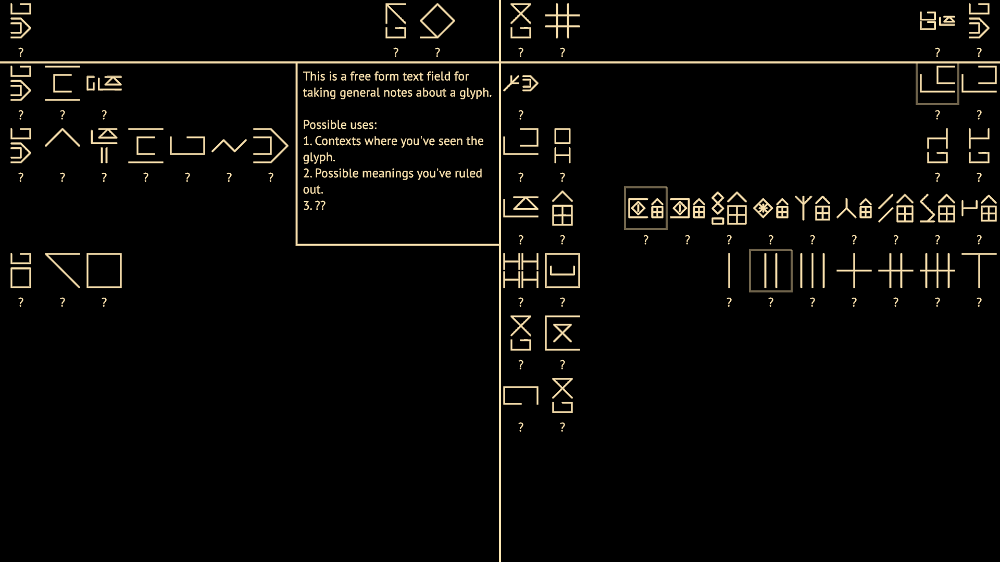

# Research Notes

A [BepInEx 5](https://github.com/BepInEx/BepInEx) plugin for [Message From Aliens](https://store.steampowered.com/app/1858720/Message_From_Aliens/) that adds a freeform notes field to each glyph's information panel.



## Installing

Install BepInEx first, if you haven't already, as described under [Requirements](#requirements). Then unzip the release zip into the game folder, the one that holds `MessageFromAliens.exe`. In Steam, right-click the game and choose Manage, then Browse local files, to open it. The zip holds `BepInEx/plugins/ResearchNotes/`, so the mod lands in BepInEx's plugins folder. To update, unzip a newer release over it. To uninstall, delete `BepInEx/plugins/ResearchNotes/`.

## Notes

When the left panel shows the first page of a glyph's information panel, shown by right-clicking the glyph, its top right corner gets an outlined notes field.

Click the field to type in it. Enter starts a new line, and the arrow keys move the cursor in all four directions. Text starts at the size of the glyph labels and shrinks to fit when there is more than fits at that size. Clicking elsewhere ends the edit and saves the note. Escape undoes the edit. Text is shown as typed, except that TextMesh Pro shows `\u` followed by four hex digits, or `\U` followed by eight, as that character.

The field spans the last five columns of the first three rows, to the right of the word type and composition lines. A row that holds glyphs in those columns is left out, so the field is shorter for glyphs whose definition starts on the third row.

Notes are saved in your save slot alongside the game's own translations, as entries whose names start with `researchnotes.note:`. The game ignores them. They stay in the save if the mod is removed. The field stays visible while the game hides translations and can be disabled separately.

## Configuration

`BepInEx/config/sparr.messagefromaliens.researchnotes.cfg`, created on first launch:

| Key | Default | Effect |
|---|---|---|
| `Notes.Enabled` | `true` | Show the notes field. |

The setting is tagged with its name in glyphs, and the mod names itself in glyphs, so Mod Settings can show them in the game.

## Requirements

- BepInEx 5.4.23.6 or later, `BepInEx_win_x64` build, unzipped into the game folder. Tested with Unity 6000.6.8f1.
- On Linux under Proton, set the Steam launch options to `WINEDLLOVERRIDES="winhttp=n,b" %command%`.
- .NET SDK 8 or later to build.

## Building

```sh
dotnet build -c Release
```

With `-p:DeployToGame=true`, the build also copies `ResearchNotes.dll` to `<game>/BepInEx/plugins/ResearchNotes/`.

The build looks for the game in `<SteamLibraryDir>/steamapps/common/Message From Aliens`. `SteamLibraryDir` comes from the first of these that is set:

1. `-p:SteamLibraryDir=/path/to/SteamLibrary` on the command line.
2. A `SteamLibraryDir` environment variable.
3. `GamePaths.props`, a copy of `GamePaths.props.example`. It is ignored by git.
4. Steam's default install location: `~/.local/share/Steam` on Linux, `C:\Program Files (x86)\Steam` on Windows.

For a game folder outside a Steam library, set `GameDir` to the game folder the same ways.

## Patches

| Method | Patch |
|---|---|
| `Draw.UpdateText` | Postfix: marks the left panel as changed, so the notes field is placed and filled again after the redraw, in the same frame. |
