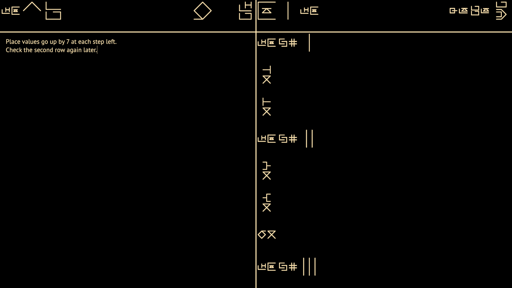

# Research Notes

A [BepInEx 5](https://github.com/BepInEx/BepInEx) plugin for [Message From Aliens](https://store.steampowered.com/app/1858720/Message_From_Aliens/) that adds freeform notes fields to each glyph's information panel, to each stage of the minigame with seven stages, and to each page.


## Installing

Install BepInEx first, if you haven't already, as described under [Requirements](#requirements). Then unzip the release zip into the game folder, the one that holds `MessageFromAliens.exe`. In Steam, right-click the game and choose Manage, then Browse local files, to open it. The zip holds `BepInEx/plugins/ResearchNotes/`, so the mod lands in BepInEx's plugins folder. To update, unzip a newer release over it. To uninstall, delete `BepInEx/plugins/ResearchNotes/`.

## Notes

When the left panel shows the first page of a glyph's information panel, shown by right-clicking the glyph, its top right corner gets an outlined notes field.

Click the field to type in it. Enter starts a new line, and the arrow keys move the cursor in all four directions. Text starts at the size of the glyph labels and shrinks to fit when there is more than fits at that size. Clicking elsewhere ends the edit and saves the note. Escape undoes the edit. Text is shown as typed, except that TextMesh Pro shows `\u` followed by four hex digits, or `\U` followed by eight, as that character.

The field spans the last five columns of the first three rows, to the right of the word type and composition lines. A row that holds glyphs in those columns is left out, so the field is shorter for glyphs whose definition starts on the third row.

Each of the seven stages of the minigame with seven stages has its own notes field, in the top right corner of the lower part of the right panel, below the line of buttons. It spans the last six columns of the first four rows there. As for glyphs, a row that holds glyphs in those columns is left out, along with the rows below it. The field is not shown on the list of stages.

## Page notes

After the right panel's explain button opens a page's explanation in the left panel, the button is replaced by a notes button, which opens a notes page for the right panel's page in the left panel. The notes page is titled with the page's name and that glyph, and holds one notes field, bounded by the panel's dividers and the screen's edge and edited as the other fields are. While the notes show, the explain button is back, so clicking it again returns to the explanation. Each page has its own notes, so each lesson and quiz has its own, even where they share an explanation. While the left panel shows a page's notes, opening another page on the right shows that page's notes in their place.



A page's notes in the left panel, beside the page they belong to.

Page notes were part of Interface Tweaks 0.3.0. With that version installed, Research Notes turns off Interface Tweaks' page notes and hides their setting from Mod Settings. When a save slot is loaded, notes that Interface Tweaks saved are moved to Research Notes' entries. If a page has different notes from both, Research Notes' come first, then a blank line, then Interface Tweaks'.

## Saving

Notes are saved in your save slot alongside the game's own translations, as entries whose names start with `researchnotes.note:` for glyphs, `researchnotes.level:` for stages, and `researchnotes.page:` for pages. The game ignores them. They stay in the save if the mod is removed. Interface Tweaks' undo, from version 0.3.0, covers them. The fields stay visible while the game hides translations and can be disabled separately.

## Configuration

`BepInEx/config/sparr.messagefromaliens.researchnotes.cfg`, created on first launch:

| Key | Default | Effect |
|---|---|---|
| `Notes.Enabled` | `true` | Show the notes fields of glyphs and stages. |
| `Notes.PageNotes` | `true` | Replace the explain button with a notes button while the explanation shows, and keep a notes page for each page. |

Each setting is tagged with its name in glyphs, and the mod names itself in glyphs, so Mod Settings can show them in the game.

## Requirements

- BepInEx 5.4.23.6 or later, `BepInEx_win_x64` build, unzipped into the game folder. Tested with Unity 6000.6.8f1.
- On Linux under Proton, set the Steam launch options to `WINEDLLOVERRIDES="winhttp=n,b" %command%`.
- Optional: [Mod Settings](https://github.com/sparr/messagefromaliens-mod-ModSettings), to change the settings in the game.
- Optional: [Interface Tweaks](https://github.com/sparr/messagefromaliens-mod-InterfaceTweaks) 0.3.0 or later, whose undo covers notes. Version 0.3.0 has page notes of its own, which Research Notes turns off, as described above.
- .NET SDK 8 or later to build.

## Building

```sh
dotnet build -c Release
```

With `-p:DeployToGame=true`, the build also copies `ResearchNotes.dll` to `<game>/BepInEx/plugins/ResearchNotes/`.

The build looks for the game in `<SteamLibraryDir>/steamapps/common/Message From Aliens`. `SteamLibraryDir` comes from the first of these that is set:

1. `-p:SteamLibraryDir=/path/to/SteamLibrary` on the command line.
2. A `SteamLibraryDir` environment variable.
3. `GamePaths.props`, a copy of `GamePaths.props.example`. It is ignored by git.
4. Steam's default install location: `~/.local/share/Steam` on Linux, `C:\Program Files (x86)\Steam` on Windows.

For a game folder outside a Steam library, set `GameDir` to the game folder the same ways.

## Patches

| Method | Patch |
|---|---|
| `Draw.UpdateText` | Postfix: marks the left panel as changed, so the notes fields are placed and filled again after the redraw, in the same frame. |
| `Draw.UpdateText1` | Prefix: while the left panel shows another page's notes, replaces them with the current page's. |
| `Draw.Write` | Prefix: in the right menu, while the left panel shows the page's explanation, replaces the explain button with the notes button. |
| `Draw.Update` | Prefix: a left click on the notes button opens the page's notes. |
| `Global.LoadGame` | Finalizer, first: moves Interface Tweaks' page notes in the loaded save to Research Notes' entries. |
| Interface Tweaks 0.3.0's `PageNotes.Tick`, `UpdatePrefix`, `WritePrefix`, and `UpdateText1Prefix` | Prefix: skips the method, turning off Interface Tweaks' page notes. |
